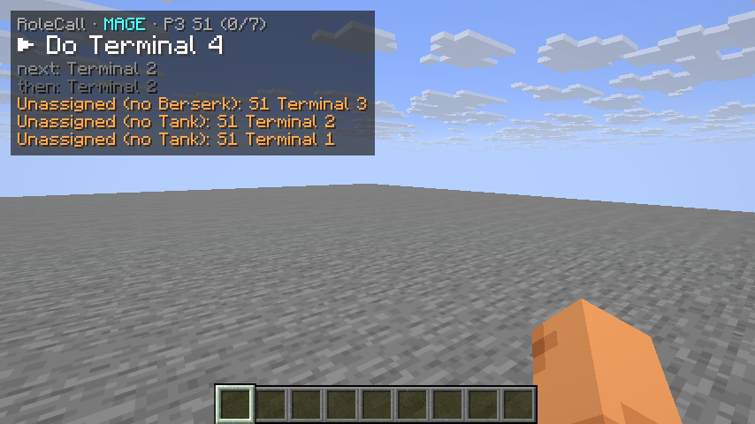
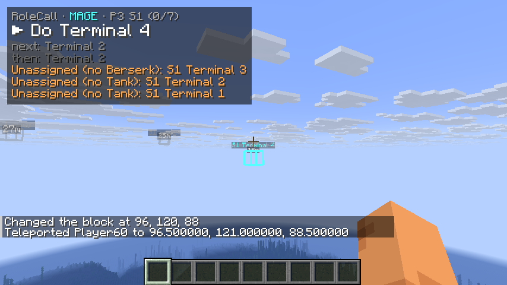
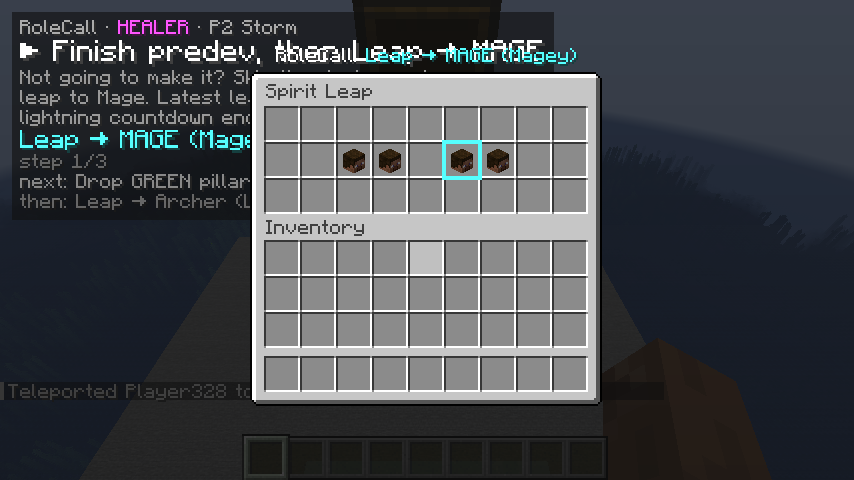
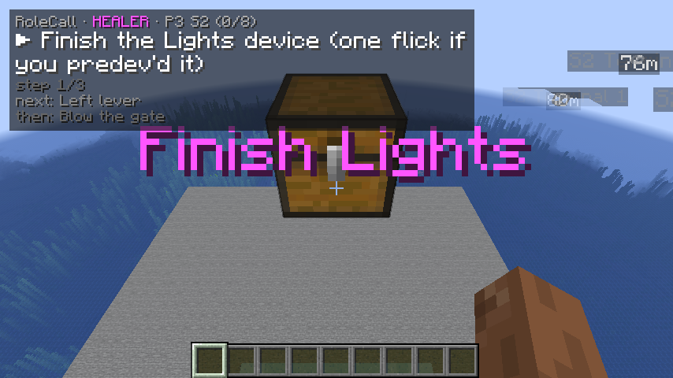
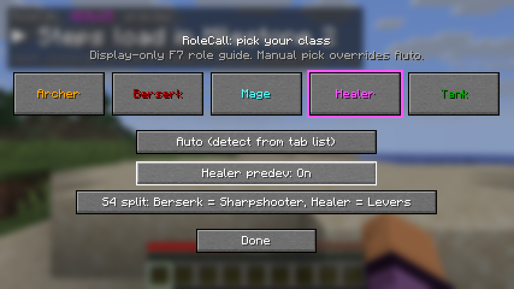

# RoleCall

A client-side Fabric mod for Hypixel SkyBlock that shows what **your** dungeon class should be doing in
**Floor 7 and Master Mode 7**, step by step, as the boss fight goes on.

> **Display-only. Use at your own risk.**
> RoleCall only reads chat, the tab list, the scoreboard and your own position. It draws HUD text,
> fixed-coordinate waypoints and an outline in the Spirit Leap menu. It never clicks, moves, aims, leaps,
> mines, solves anything or sends chat/party messages for you, and it does not touch packets. Hypixel's
> Allowed Modifications rules still apply, and any mod can get you banned. You use it at your own risk.



## What it does

- **Knows your class**: read from the dungeon tab list, or picked by hand with `/rolecall`. A manual pick
  wins until you choose Auto again.
- **Knows where the run is**: floor from the sidebar (`The Catacombs (F7)` / `(M7)`), phase from the boss
  chat lines, P3 section and progress from the terminal/device/lever messages, and the gates, Storm's
  lightning and the core opening. If you join late or relog, it estimates the phase from your height (Odin's
  Y bands) and the P3 section from where you're standing.
- **HUD**: `RoleCall · HEALER · P3 S2 (5/8)`, your current step in large text, a grey note, `Leap → MAGE
  (TheirName)`, then the next two steps (also across phases: `next: S2: Terminal 2`). In P3 it also lists
  jobs nobody can do because a class is missing (`Unassigned (no Healer): S1 Simon Says`) and tells you when
  you share your class (`2× Mage: split "Terminal 4" with your duplicate`).
- **Steps advance by themselves** when the thing they wait for happens: your terminal/lever/device
  completes, the gate blows, lightning starts, Storm dies, or you reach a spot (Healer predev). Bind the
  "Next step" / "Previous step" keys if you want to move it yourself (this only changes the HUD).
- **Title + ding** when your step changes, and a big `LIGHTNING / get under your pillar` warning.
- **Waypoints** (box, label, distance) on **only your** objectives for the current step. A completed one
  is hidden by finding the player who completed it and hiding the nearest objective of that kind, which is
  the same approach Skyblocker uses. `/rolecall set others on` also shows the rest of the section, dimmed.
- **Spirit Leap menu**: outlines the head of the player you should leap to. Render only.
- **Your own spots and routes**: `/rolecall here` and `/rolecall route` (for example the Healer predev
  mining route), drawn as numbered points joined by a line.
- **M7 P5**: relic and dragon-side reminders, plus waypoints on the relic cauldrons and dragon spawns.

| | |
|---|---|
|  |  |
|  |  |

## Install

1. Minecraft **26.1.2** with Fabric Loader **0.19.3+**.
2. Put `rolecall-0.2.0.jar` and **Fabric API** (0.154.0+26.1.2 or newer for 26.1.2) in `.minecraft/mods/`.

No other mods are needed. The floor comes from the scoreboard, so the Hypixel Mod API isn't required.

## Commands

| Command | What it does |
|---|---|
| `/rolecall` | Class picker: 5 classes + Auto, Healer predev (Auto/On/Off), S4 split |
| `/rolecall class <archer\|berserk\|mage\|healer\|tank\|auto>` | Set your class without the GUI |
| `/rolecall hud` | Move (drag) and scale (scroll) the HUD |
| `/rolecall status` | Print your class, the phase and the current step (with its source) |
| `/rolecall next` · `/rolecall back` | Move the HUD to the next/previous step (display only) |
| `/rolecall here <id> [label]` · `/rolecall unhere <id>` | Save/remove a spot at your feet (e.g. `ss_wait`) |
| `/rolecall route <name> add\|undo\|clear\|list` | Build a route point by point (`predev` is shown during Healer predev) |
| `/rolecall reload` | Re-read the JSON files and print any problems |
| `/rolecall debug` | Overlay with everything RoleCall detected (scoreboard line, phase, section, party, nearest objective…) |
| `/rolecall sim <f7_full\|m7_p5\|yours\|stop>` | Play a fake run **locally** to check the HUD (nothing is sent to the server) |
| `/rolecall set <titles\|sound\|lightning\|waypoints\|others\|leap\|hud> [on\|off]` · `/rolecall set volume <0-2>` | Toggles |

Keybinds (Options → Controls → RoleCall, unbound by default): Next step, Previous step, Open class picker.

**Predev toggle:** Auto turns predev on when the party has a Healer. With predev off, the Healer's predev
steps are hidden, and the Archer goes to the S1 levers instead of waiting at Simon Says.
**S4 split:** "Berserk = Sharpshooter, Healer = Levers" or the reverse. Those two agree on it each run.

## Editing the steps (match the ADG video)

All role text is data, not code. Your edits go in `config/rolecall/` and survive updates:

- `config/rolecall/roles.json`: steps are matched by `id` within a class. Give the id and only the
  fields you want to change. `"remove": true` deletes a step. A new id adds a step, and
  `"after": "<id>"` places it after an existing one.
- `config/rolecall/objectives.json`: same idea for waypoints.
- `config/rolecall/user_waypoints.json`: written by `/rolecall here` and `/rolecall route`.
- `config/rolecall/sim/<name>.txt`: your own sim scripts (format in `SimScript.java`).

```json
{"classes": {"MAGE": [
  {"id": "m_s1_t4", "text": "Do Terminal 4, then help Tank with Terminal 1"},
  {"id": "m_clear_1", "phase": "CLEAR", "text": "Blood rush with the Archer"}
]}}
```

Step fields: `id`, `phase` (CLEAR, P1, P2, P3, P3_TUNNEL, P4, P5), `section` (1-4, P3 only), `text`,
`shortText` (title), `note`, `leap` (class), `waypoints` (ids), `route`, `floors` (`["M7"]`), `requires`
(`{"predev": true}` / `{"s4split": "bers_device"|"bers_levers"}`), `until` (`{"event":
"lightning"|"storm_dead"|"gate"|"core"}`, `{"objectiveDone": [ids]}`, `{"reached": id, "radius": 5}`,
`{"manual": true}`), `src`. Run `/rolecall reload` after saving. Bad JSON never crashes the game: the
problem is printed and everything else still loads.

## Where the data comes from, and how sure it is

| Data | Source | Status |
|---|---|---|
| Boss chat lines (P1-P5, lightning, gate, core, progress) | Odin `SplitsManager`/`TickTimers`/`TerminalsStatus`, Skyblocker `DungeonSplitsWidget` | Checked against both, unit-tested |
| Tab list class regex | Odin `DungeonUtils` (also accepts ranks like `[MVP+]`) | Checked |
| Boss-room check, Y-band fallback | Odin `DungeonListener` / `getF7Phase` | Checked |
| P3 terminal/device/lever coordinates | Skyblocker `goldorwaypoints.json`; Odin agrees on SS and Arrow Align | Checked |
| M7 relic cauldrons, dragon spawns | Odin `KingRelics`, `WitherDragonsEnum` | Checked |
| F7 role steps (P1-P4, all classes) | hypixel.net "Floor 7 Guide (Advanced)" (thread 5984063) | Matches the guide; unit test locks the P3 table |
| M7 P1-P4 | Same steps as F7 | Most guides agree; check |
| M7 P5 (relics, dragon teams) | hypixel.net M7 threads 5479620, 5828596, 5775844 | ⚠ Forum sources disagree in places; relic colour per class is only known for Mage (blue) and Healer (purple) |
| Clear phase | none yet | TODO: fill in from the ADG video |

Fixed while checking: the guide's "leap to Mage if you won't make it" belongs to the Healer's predev in
P2, not to P3 S3. Also, the guide's S4 "Healer: 3rd terminal" is treated as a typo, because Berserk owns
S4 T3.

## Verify in game (checklist)

- [ ] `/rolecall debug` shows `scoreboard: The Catacombs (F7)` and the right floor in a real run
- [ ] Tab-list regex picks up all 5 classes and your own IGN (no `unmatched tab` lines in debug)
- [ ] Boss messages still match (phase changes on each boss line)
- [ ] Terminal numbering per section matches the community "Nth terminal" numbering (fix in `objectives.json` if not)
- [ ] Which S2 lever is "left" vs "right" from the usual approach (`s2_lever_left` = 23,132,138 is a guess)
- [ ] Waypoints sit on the right blocks (1-block offsets happen)
- [ ] Spirit Leap menu title is still `Spirit Leap`, and the right head gets outlined
- [ ] Role text matches the ADG video; edit `config/rolecall/roles.json` where it differs
- [ ] M7 P5 relic colours for Archer/Berserk/Tank

## Build (Debian)

```bash
sudo apt install openjdk-25-jdk-headless
```

```bash
./gradlew build
```

The jar path is printed at the end: `build/libs/rolecall-<version>.jar`. `./gradlew test` runs the
engine tests (full F7 and M7 runs for every class, no Minecraft needed). `./gradlew runClient` starts a dev
client. If your default `java` isn't 25, set `JAVA_HOME=/usr/lib/jvm/java-25-openjdk-amd64` first.

Versions are copied from CollectionClimb: Minecraft 26.1.2, Loader 0.19.3, Fabric API 0.154.0+26.1.2,
Loom 1.17.13, Java 25.
